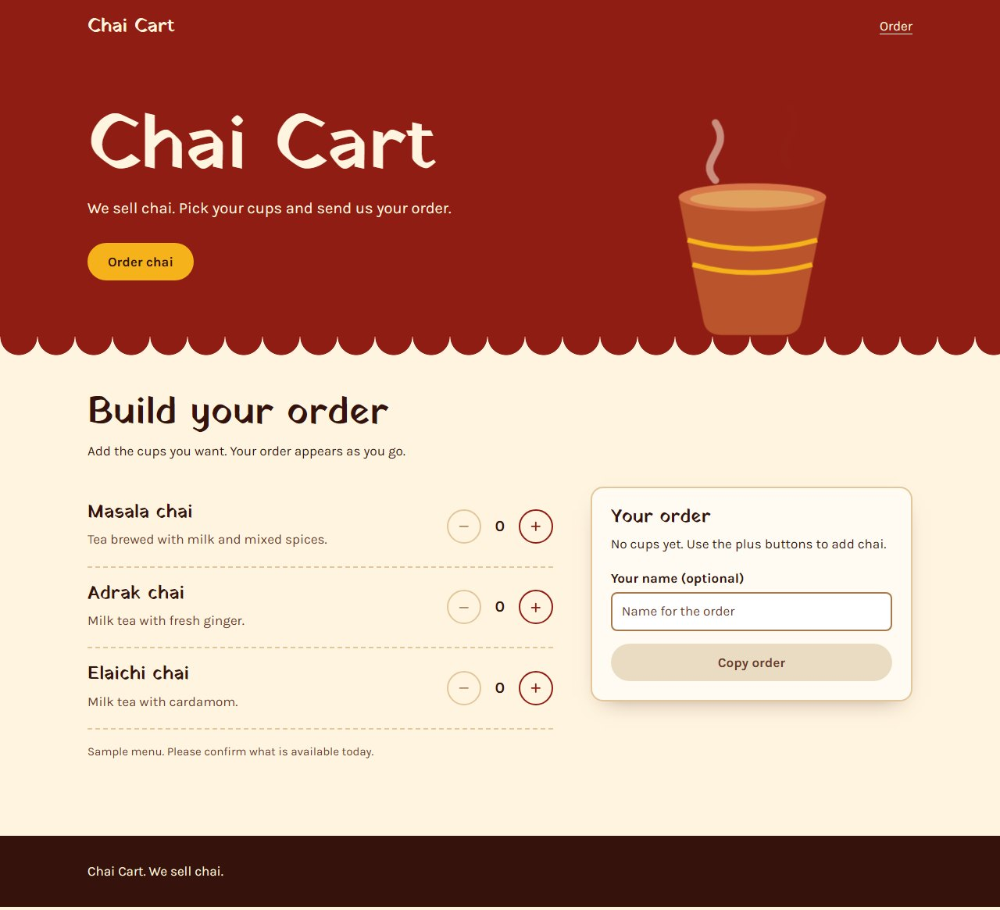

<div align="center">


# Graut

### Tention mat le, teri problem me graut bhar denge.

**Web development, AI development, machine learning ya kuch bhi: sabme Graut bhar denge, ye skill use karke.**<br>
Koi bhi software problem ho, usme graut bhar denge aur solve kar denge.

by **Pranjal**

```bash
npx graut-bhar-de
```

</div>

---

## What is Graut?

One skill for Claude Code, Codex, Antigravity and other coding agents, with 34 specialists inside. Say your problem in a few words. Graut works out what it needs, loads the right expertise, builds it, **checks it before calling it solved**, and remembers your project.

## Install

You need [Node.js](https://nodejs.org) 18.3 or newer (22 or newer for the video skills) and [git](https://git-scm.com). Run these in a terminal (PowerShell, Terminal or bash), **not** in the chat box.

### 1. One command (recommended)

```bash
npx graut-bhar-de
```

### 2. Or install it once, then use `npx graut`

```bash
npm install -g graut-bhar-de
```

```bash
npx graut
```

npm only downloads the package; `npx graut` is what sets it up. (npm does not allow a package named exactly `graut`, so the install name is `graut-bhar-de`.)

### 3. Or with git clone

```bash
git clone -c core.longpaths=true https://github.com/Pranjal240/Graut.git
```

```bash
cd Graut
```

```bash
node skills/graut/scripts/graut.js
```

### Then

1. If it asks to install FFmpeg or Python, accept. If it ends with `do this: ...`, run that command, open a **new** terminal and run the install again.
2. Close and reopen Claude Code (or your agent).
3. Check everything: `npx graut-bhar-de doctor`

### Only inside Claude Code

Type these in Claude Code:

```
/plugin marketplace add Pranjal240/Graut
/plugin install graut@graut
```

In the desktop app: click **+** beside the prompt box, **Plugins**, **Add marketplace** `Pranjal240/Graut`, then **Add plugin**. This gives you the panel and every skill. Say **set up graut** afterwards to install the tools the skills need.

## Use

In Claude Code, with the plugin:

```text
/graut:graut tests fail, fix it
/graut:graut my model has 99% accuracy but fails in production
/graut:impeccable audit my landing page
/graut:ui-ux-pro-max design system for a chai shop
/graut:brag-slim
kya karu? my app is slow
```

Every skill below has its own `/graut:<name>` command. In other agents, or when Graut is installed as a plain skill, write `/graut impeccable audit my landing page`.

| When | Graut says |
|---|---|
| Starting a task | Tention mat le, teri problem me graut bhar denge |
| You ask "kya karu?" | Isme Graut bhar denge, and then the answer |
| It needs something from you | teri problem me graut to bhar diya, par isse kam nhi chalega (do this: ...) |
| Solved and checked | le bhai isme graut bhardiya |

## The panel

In Claude Code, Graut sits above the prompt:

```text
GRAUT by Pranjal   Tention mat le, teri problem me graut bhar denge
[off] [lite] [* full] [ultra] | [Review] [Audit] [Doctor] [Copy] [Compact]
cost $0.42 last $0.11   tokens 1.2M   time 4m 10s 3 turns   tests 11 passed   skills ui-ux-pro-max
```

| Level | What Graut does |
|---|---|
| `off` | Stays out of the way |
| `lite` | The short version; specialists only when needed |
| `full` | Everything (default) |
| `ultra` | Loads every matching specialist, plans in writing, verifies, reviews its own work |

Other agents: `npx graut-bhar-de level ultra`. If you also have the ponytail plugin, Graut already includes it; `claude plugin disable ponytail@ponytail` leaves only the Graut panel.

## What install sets up

| Set up | For |
|---|---|
| The Claude Code plugin | the panel and `/graut:<name>` commands |
| The `graut` skill in Codex, Antigravity, Gemini CLI, Cursor, OpenCode, Copilot CLI, Windsurf and Kiro | whichever you have |
| git, uv, Python, FFmpeg (through winget or Homebrew) | design and video skills |
| `python3` on Windows | skills that call it |
| Python packages: numpy, scipy, pillow, google-genai | `design`, `day-in-my-life` |
| Node packages | `day-in-my-life`, `session-story`, `p5-paint-animation` |
| The design engine and the video tool | `impeccable`, HyperFrames skills |
| A short note in `CLAUDE.md`, `AGENTS.md`, `GEMINI.md` (old file saved as `.graut.bak`) | keeps Graut on |

Two features need your own account: image generation in `design` needs a `GEMINI_API_KEY`, and HeyGen voices and avatars in `media-use` need a HeyGen login.

## Fewer tokens in every agent

- **One skill to list.** Claude Code, Codex, Antigravity and the rest see `graut`, not 35 skills. Specialists are read only when a task needs them. In Claude Code the 34 direct commands add nothing to a session (measured).
- **Lean working rules.** Graut limits command output, reads only what the task needs and keeps replies short, without skipping checks.
- **Nothing lost.** A loaded specialist is followed in full, exactly as its author wrote it, with Graut's planning, checking and memory around it.

## Something not working?

| You see | Do this |
|---|---|
| Anything unclear | `npx graut-bhar-de doctor` names what is missing and the command that fixes it |
| No panel, no `/graut:` commands | Close Claude Code fully and reopen it; check `claude plugin list` shows `graut@graut` |
| `Python was not found` | Run the install again, or use `python` instead of `python3` |
| `ffmpeg` not found after installing it | Open a new terminal |
| Video render fails on first use | Run `npx --yes hyperframes@latest doctor` |

## What is inside

| For | Inside Graut |
|---|---|
| Web, AI apps, machine learning, debugging | Graut playbooks |
| Routing, chaining, subagents, memory, new skills and agents | `graut` |
| Writing less code | `ponytail`, `ponytail-review`, `ponytail-audit`, `ponytail-debt`, `ponytail-gain`, `ponytail-help` |
| Correct engineering | `gravitas`, `gravitas-highstakes`, `gravitas-python`, `gravitas-typescript` |
| Design | `ui-ux-pro-max`, `impeccable`, `design`, `brand`, `design-system`, `ui-styling`, `banner-design`, `slides` |
| Video | `brag`, `brag-slim`, `hyperframes`, `hyperframes-cli`, `hyperframes-registry`, `media-use`, `camera-3d-captions`, `day-in-my-life`, `duo`, `p5-paint-animation`, `prod-by-claude`, `session-story`, `vox-explainer`, `x-posting-license` |
| Turning a person's thinking into a skill | `huashu-nuwa` |
| Skill safety | `skill-inspector`, with NVIDIA SkillSpector |
| Everything else | `find` searches skills on your machine and thousands in the bundled catalogs; `add` gives one to Graut |

## From four words to a website

A one-line page and the prompt "make this website good" gave this (the menu items are samples, and the page says so):

<div align="center">

</div>

## Commands

Prefix each with `npx graut-bhar-de` (or `npx graut` after the global install).

| Command | Does |
|---|---|
| `install` (default) | set up or update |
| `doctor` | show what is installed and missing |
| `level [name]` | show or change the level |
| `find <words>` | search local skills and catalogs |
| `add <id>` | scan one catalog skill and give it to Graut |
| `uninstall` | remove what Graut installed |

| Option | Does |
|---|---|
| `--agents claude,codex` | only these agents |
| `--no-activate` | leave instruction files alone |
| `--no-plugin` | Claude Code: the skill only, without the plugin and panel |
| `--no-system-deps` | do not install tools or packages |
| `--allow-risky` | with `add`, add a catalog skill despite a failed or missing scan |

## Good to know

- Skills are instructions and scripts that your agent runs with your permissions.
- Some skills use the network or your API keys when you run them: `impeccable` and the HyperFrames tools download their programs, and `design` calls the image provider you give it a key for. Graut asks before any of them sends usage data.
- `session-story` and `day-in-my-life` read your local agent transcripts to make their films.

## Maintaining

```bash
npm test
claude plugin test .
```

To update a specialist, change its `sha` in [sources.json](skills/graut/sources.json), run `npm run sync`, read the diff, then commit.

## Contributing

Ask first: see [CONTRIBUTING.md](CONTRIBUTING.md). Nothing is merged without the owner's approval.

## License and credits

Graut, its playbooks, panel and installer are by Pranjal, under the MIT license. The bundled specialists are open source work by their own authors, each shipped with its license: see [CREDITS.md](CREDITS.md).
